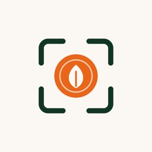
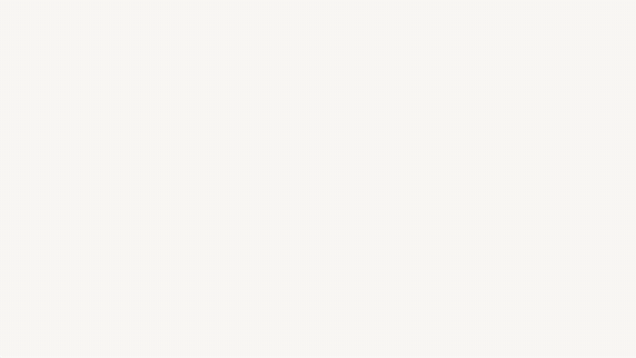

<p align="center"></p>

<h1 align="center">SAVOR</h1>

<p align="center"><b>Smart AR Visualization for Optimized Restaurant ordering</b></p>

<p align="center"><i>Savor the sight before you order.</i></p>



SAVOR membantu restoran menurunkan sisa makanan (food waste) dengan cara
sederhana namun powerful: pelanggan melihat **porsi makanan dalam ukuran asli
(1:1) langsung di atas meja mereka** lewat Augmented Reality - cukup scan QR,
tanpa install aplikasi apa pun.

Masalahnya mudah dipahami siapa pun yang pernah makan di restoran: foto menu
selalu membuat porsi terlihat lebih besar dari kenyataan. Pelanggan memesan
lebih banyak dari yang sanggup dimakan, makanan tersisa, terbuang. SAVOR
mengganti foto dengan model 3D hasil scan benda asli, sehingga yang dilihat
pelanggan = yang akan datang ke meja. Target: **SDG 12.3** (memangkas food
waste hingga 50% pada 2030).

> Proyek untuk **UINIC 8.0 - Web Development Competition**
> Tema: *Engineering Interconnected Web Solutions to Empower Digital Ecosystems*
> Subtema: *Lingkungan*

---

## Demo Online (dapat langsung dibuka juri)

| Apa | Link |
|---|---|
| Menu publik pelanggan (buka dari HP!) | https://frontend-ecru-nine-78msnkzo1b.vercel.app/public/meja-aresto?table=T-01 |
| Dashboard pemilik restoran | https://frontend-ecru-nine-78msnkzo1b.vercel.app/login |
| API docs (Swagger) | https://savor-api2.vercel.app/docs |

**Akun demo:** demo@savor.id / SAVOR-2026! *(atau klik tombol "Gunakan akun
demo" di halaman login - terisi otomatis)*

**Cara merasakan AR (30 detik):**
1. Buka link "Menu publik" dari **HP** (bukan laptop)
2. Scroll ke *Burger Beef Klasik* -> ketuk **"Lihat di Meja (AR)"**
3. Arahkan kamera ke lantai/meja -> burger ukuran asli muncul di depanmu
4. Putar, dekati, bandingkan dengan piring - itulah porsi yang akan datang

*Di laptop, 3D tetap bisa diputar 360 derajat sebagai pratinjau; tombol AR
aktif saat dibuka dari HP (butuh kamera).*

---

## Cara Kerja (versi singkat)

```
[Kreator mitra]              [Restoran]                  [Pelanggan]
Scan makanan asli        ->  Upload file 3D (GLB)   ->   Scan QR di meja
dengan iPhone LiDAR          lewat dashboard             Menu 3D muncul via AR
(aplikasi Polycam)           (2 menit per menu)          di browser HP-nya
```

- **Pemilik restoran** login ke dashboard: kelola menu, upload model 3D & foto,
  generate QR per meja (siap print), lihat statistik menu mana yang paling
  menarik perhatian pelanggan.
- **Sistem kasir (POS) terhubung**: saat dapur kehabisan suatu menu, staf
  cukup menandainya di kasir -> menu di semua meja otomatis muncul tanda
  **"Sementara Habis"** dalam hitungan detik.
- **Pelanggan** tidak perlu akun, tidak perlu install - scan dan langsung
  melihat.

---

## Fitur

| Fitur | Keterangan |
|---|---|
| AR tanpa aplikasi | Jalan di browser HP (Scene Viewer Android / Quick Look iOS) - teknologi bawaan, nol friksi |
| Porsi 1:1 sebenarnya | Model 3D berukuran asli; pelanggan membandingkan langsung dengan meja/piring |
| Sinkron kasir (POS) | API ber-key: ketersediaan menu tersinkron dengan stok dapur secara real-time |
| QR per meja | Generate & print QR dari dashboard; setiap meja punya menu sendiri |
| Statistik minat | Menu mana paling dilihat & paling di-AR - dasar keputusan daftar menu (tanpa data pribadi pelanggan) |
| Aksesibel & cepat | Lighthouse: Performance 96, Accessibility 100, Best Practices 96, SEO 100 |
| Fallback 2D | Perangkat tak mendukung AR? Foto asli otomatis menggantikan - semua orang terlayani |

---

## Menjalankan versi lokal (satu klik!)

Versi **lokal memiliki seluruh fitur tanpa batasan** (lihat catatan mode online
di bagian bawah). Untuk Windows 10/11:

1. **Download** - git clone https://github.com/MrEuwn/mejaar.git atau tombol
   Code -> Download ZIP lalu extract
2. **Double-click start.bat** - script otomatis:
   - memasang Node.js & uv bila belum ada (via winget)
   - memasang dependencies + data demo (hanya kali pertama)
   - menjalankan backend, frontend, dan tunnel HTTPS untuk AR di HP
   - membuka browser begitu semuanya siap
3. **Selesai** - halaman login terbuka. Klik "Gunakan akun demo".

Menghentikan: double-click stop.bat.

<details>
<summary>Prefer cara manual? (klik untuk buka)</summary>

```
cd backend  && uv sync && uv run uvicorn app.main:app --port 8000   # API :8000
cd frontend && npm install && npm run dev                            # Web :3000
# data demo: cd backend && uv run python seed_demo.py
```
</details>

---

## Bagaimana SAVOR dibangun (ikhtisar untuk yang penasaran)

SAVOR adalah aplikasi web **multi-tenant** (satu server, banyak restoran, data
masing-masing terisolasi dan diuji otomatis), terdiri dari:

- **Frontend** - Next.js + TypeScript + Tailwind CSS. Halaman menu publik
  mobile-first; 3D & AR memakai standar web terbuka via @google/model-viewer
  (WebXR / AR Quick Look / Scene Viewer).
- **Backend** - FastAPI (Python) dengan struktur modular (router, service,
  repository, schema). REST API yang sama dipakai dashboard web dan sistem
  POS - inilah "interconnected" dalam tema kompetisi.
- **Keamanan** - password di-hash (argon2), sesi JWT + refresh token, API key
  ter-hash untuk mesin, validasi upload (magic bytes, bukan sekadar ekstensi
  file), rate limiting, security headers, isolasi data antar tenant.
- **Kualitas terukur** - 35 unit test otomatis (pytest), lint bersih (ruff),
  uji beban k6 (p95 = 100 ms pada 20 pengguna virtual, target < 300 ms).
  Semua angka dapat direproduksi - lihat docs/TEST_REPORT.md.
- **Siap produksi** - Docker Compose tersedia (PostgreSQL + Redis); mode
  pengembangan otomatis memakai SQLite agar nol-friction.

Penjelasan arsitektur lengkap: docs/ARCHITECTURE.md.

---

## Dua mode penayangan: lokal lengkap vs online demo

|  | Mode Lokal (start.bat) | Mode Online (link demo) |
|---|---|---|
| Fungsi inti (menu, QR, AR, statistik) | lengkap | berfungsi |
| Upload model/foto persisten | tersimpan | sementara (demo pakai data awal) |
| Integrasi POS & simulator | ya | ya |
| Data tersimpan antar sesi | ya | di-seed ulang otomatis |

**Kenapa ada perbedaan?** Versi online sengaja di-deploy di platform gratis
**tanpa kartu kredit** (Vercel serverless) dengan penyimpanan sementara -
cukup untuk menunjukkan seluruh alur produk. Secara arsitektur, SAVOR siap
memakai database terkelola (PostgreSQL) dan object storage (S3) hanya dengan
mengganti variabel lingkungan; penjelasan jujurnya ada di docs/DECISIONS.md -
sesuai prinsip kompetisi: *yang belum teruji ditulis sebagai roadmap, bukan
sebagai fitur.*

---

## Dokumentasi

| Dokumen | Isi |
|---|---|
| docs/PRD.md | Product requirements (sumber kebenaran proyek) |
| docs/ARCHITECTURE.md | Diagram arsitektur & keputusan teknis |
| docs/DECISIONS.md | Setiap deviasi dari PRD + alasannya (transparansi) |
| docs/API.md | Referensi endpoint & contoh |
| docs/USER_GUIDE.md | Panduan pengguna per peran (pemilik/staf/pelanggan) |
| docs/TEST_REPORT.md | Semua hasil pengujian + cara mengulangnya |
| docs/ASSETS.md | Kredit aset 3D & foto (CC0 / CC BY) |

## Tim

- **Tim**: Sembarang Wes
- Aset 3D & foto memakai lisensi terbuka (CC0/CC BY) - kredit per file di
  docs/ASSETS.md
- Kode proyek: lisensi MIT
