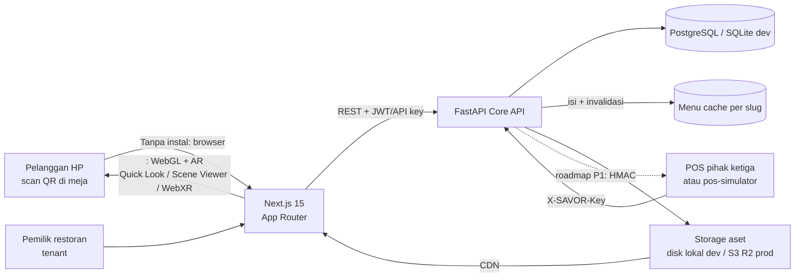

# Arsitektur SAVOR

## Diagram end-to-end

## Lapisan dan pilihan (terkunci oleh PRD bagian 7)

| Lapisan | Pilihan | Alasan |
|---|---|---|
| Frontend | Next.js 15 (App Router), TypeScript, Tailwind v4, `@google/model-viewer` | AR tanpa instal; SSR/ISR untuk halaman menu |
| Backend | FastAPI (Python), Pydantic, SQLAlchemy 2, Alembic, `uv` | Satu stack mudah menampung worker AI (P1) |
| DB | PostgreSQL (prod, docker-compose), SQLite (dev) | Relasional; `DATABASE_URL` satu kode dua dialect |
| Cache | `MenuCache` in-memory per slug, TTL 60s + invalidasi eksplisit | P0 sederhana; P1 Redis (T18) |
| Storage | Disk lokal via `StaticFiles` (dev), S3-compatible via env (prod) | Aset 3D minimal; signed URL siap dikonfigurasi |
| Auth | JWT access 15m + refresh 14h (rotasi, revokasi di DB), argon2id, RBAC | Pemisahan manusia/mesin |
| POS | API key `mk_mat_*` tersimpan hashed SHA-256, header `X-SAVOR-Key` | Mesin tak pegang JWT |
| Rate limit | slowapi, in-memory, limit via `RATE_LIMIT_PUBLIC` | Cukup untuk MVP demo |
| CI | GitHub Actions: ruff + pytest backend (job frontend menyusul T8) | Bukti kualitas di riwayat commit |

## Keputusan penting (detail: docs/DECISIONS.md)

1. **Storage lokal untuk demo**: `StaticFiles` menayangkan `storage/t{tenant_id}/...`. URI publik dihitung `asset_url()`. Untuk prod, isi env S3 (`STORAGE_BACKEND=s3`) — kode sudah punya integritas lokasi; S3 driver menyusul saat T12.
2. **Isolasi tenant di lapisan repository**: semua query `WHERE tenant_id = ...` (bukan hanya di router); dibuktikan oleh `test_menu.py::test_tenant_isolation` dan `test_pos.py::test_pos_key_cannot_touch_other_tenant`.
3. **Error seragam** `{"error":{"code","message"}}` via exception handler terjadwal; tak ada stack trace ke klien.
4. **Aset 3D "replay mode"**: kreator scan pakai iPhone LiDAR (Polycam/KIRI) lalu upload GLB (`<=3 MB`, validasi magic bytes). Rekonstruksi otomatis dari foto = F13 (roadmap P2) — bukan fitur MVP.
5. **Menu publik mengembalikan semua item** dengan `is_available`; UI menampilkan badge "Sementara Habis". Ini sengaja: demo harus menunjukkan perubahan (POS/API key) secara visual.

## Fallback AR (kriteria US3)

`<model-viewer>` dengan `ar-modes="webxr scene-viewer quick-look"`:
- iOS Safari → AR Quick Look
- Android Chrome → Scene Viewer
- Browser lain → WebXR bila didukung
Gagal/unsupported → poster (2D) tampil otomatis. `ar` attribute otomatis menyembunyikan tombol AR bila tak didukung.

## Data flow "stok habis" (US4)

POS `PATCH /pos/items/{ext}/availability` → row diubahkan → `menu_cache.clear_slug()` → GET publik berikutnya memasuki DB → UI memperbarui dalam <60s (TTL) atau instan (invalidasi eksplisit).

## Keamanan (OWASP baseline)

- Password: argon2id; token: HS256, kedaluwarsa; refresh dicabut.
- Upload: validasi magic bytes (bukan ekstensi), batasan 2/3 MB, filename disanitasi.
- CORS: `CORS_ORIGINS` eksplisit; header Authorization & X-SAVOR-Key dibatasi cakupan.
- Event publik: tanpa PII, rate-limit, item tak dikenal → 204 (tak bocorkan keberadaan).
- Tak ada secret di repo; hanya `.env.example`.

## Skala & bottleneck

p95 target GET publik <300ms diuji dengan k6 (T14). Bottleneck dev: SQLite single-writer (cukup untuk demo); migrate PostgreSQL + Redis antrean (P1, T18) untuk beban riil.
